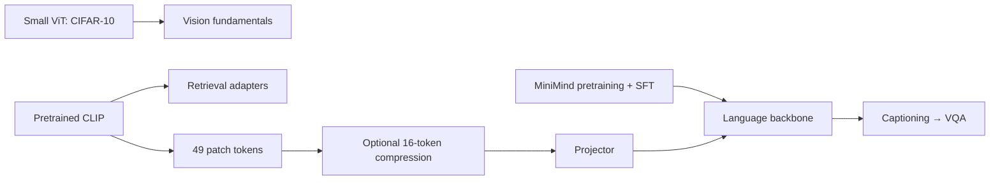

# Learning to Extend MiniMind

A compact learning project that follows MiniMind from language training to image captioning and visual question answering. Built from experiments on one RTX 5090 D, with selected implementations and an honest account of what worked.

The main outcome is a working learning and evaluation pipeline. The experiments do **not** establish a consistently better general-purpose multimodal model.

## Learning path



The hand-written classification ViT is a separate exercise. Captioning uses CLIP ViT-B/32 patch features; retrieval adapters are also a separate experiment.

## Selected results

| Experiment | Observation | Takeaway |
|---|---|---|
| Small ViT, CIFAR-10 | Patch 4: **74.58 ± 0.43%**; patch 8: 67.16 ± 0.33% | Fewer tokens reduced compute and accuracy. |
| CLIP adapters, Flickr8k | Image→text / text→image R@1: **75.93% / 61.51%** | Lightweight adaptation improved this retrieval task. |
| Caption compression, Flickr8k | Raw 49 / pooled 16 / query 16 CIDEr: **0.3363 / 0.3050 / 0.3138** | Query pooling recovered part of the compression loss. |
| COCO image breadth | CIDEr **0.4469→0.4644**; CHAIR_s **44.37→45.20%** | Better reference matching did not mean better object factuality. |
| VQAv2 reserved subset | Projector-only / last-layer tuning: **31.37% / 30.73%** | Short-answer behavior emerged; reliable detailed grounding remains unproven. |

ViT and compression numbers summarize three training seeds; ± is the sample standard deviation. Results belong to different fixed protocols and are not a cross-dataset leaderboard. [Experimental context and limitations](docs/EXPERIMENTS.md) · [Machine-readable evidence](results/)

## Core implementation

| File | What to study |
|---|---|
| [model_minimind.py](minimind_ext/model_minimind.py) | Pinned upstream decoder: RMSNorm, RoPE, GQA, SwiGLU and KV cache |
| [vit.py](minimind_ext/vit.py) | Patch embedding, CLS token and bidirectional transformer blocks |
| [clip.py](minimind_ext/clip.py) | Identity-initialized adapters, multi-positive contrastive loss and retrieval |
| [captioner.py](minimind_ext/captioner.py) | Visual placeholder replacement and gradients through a frozen language model |
| [compression.py](minimind_ext/compression.py) | Fixed pooling, 100-parameter spatial weights and a 200,208-parameter query residual |
| [data.py](minimind_ext/data.py) | Assistant-only labels, EOS supervision and padding masks |
| [vqa_score.py](minimind_ext/vqa_score.py) | Strict VQAv2 scoring with pinned official normalization tables |

The language model has about 63.91M parameters: width 768, 8 layers and a 6,400-token vocabulary. CLIP produces `[49, 768]` patch features. A 1,182,720-parameter projector maps them into the language space. Only answer tokens and EOS receive supervision.

## Try the core

Use Python 3.12 and PyTorch 2.8. Install the appropriate PyTorch build for your hardware first, then:

```bash
python -m pip install -e .
python -m examples.smoke
python -m unittest discover -s tests -v
```

The smoke example uses random CPU tensors and requires no weights or downloads. [Usage](docs/USAGE.md) covers training and inference with local language weights and cached CLIP patches. These portable examples illustrate the core; they do not reproduce every archived training and evaluation protocol.

## Next steps

1. Establish VQA gains over question-only answer priors and matched/shuffled image controls.
2. Use a fresh image-disjoint evaluation set, fixed decoding and multiple training seeds.
3. Track caption retention and factuality alongside answer accuracy before expanding model capacity.

## Scope and attribution

This release keeps the core code, tokenizer, a few result summaries and short English notes. Weights, datasets, feature caches, generated webpages and repeated tuning logs stay outside Git.

MiniMind source is pinned to [`f659b55`](https://github.com/jingyaogong/minimind/tree/f659b55761b754d306bd140573493a6543cafd7f). [Attribution](NOTICE.md) preserves third-party licenses; [provenance](results/provenance.json) records original source hashes and the selected evidence. Historical experiment results were collected before this curation and were not rerun for publication.
